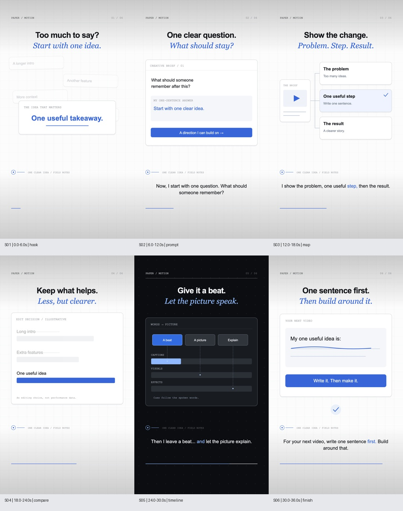

# Paper Motion Studio

Original vertical explainers made in code: light paper grids, kinetic typography, blue italic emphasis, animated UI cards, diagram reveals and frame-timed sound.



[Watch the 36-second example](examples/one-clear-idea/one-clear-idea.mp4) · [Example and source project](examples/one-clear-idea/) · [Visual guide](references/visual-guide.md) · [Reference review coverage](references/reference-study.md)

This is a new studio, separate from What If Animation and Quiet Frame Studio. It interprets the broad visual vocabulary of the four supplied mrcreates.ai reels. Reference footage, artwork, branding, avatar, script and soundtrack are not included.

## Run the example

Requirements: Node 18+, Python 3.10+, FFmpeg and FFprobe on PATH. The bundled project uses Remotion 4.0.530, React 19 and SVG/HTML artwork. Rendering downloads Chrome Headless Shell on the first run if needed.

```bash
bash setup.sh
source .venv/bin/activate
python scripts/test_pipeline.py
npm --prefix studio run typecheck
node scripts/render.mjs board examples/one-clear-idea/project.json
# Inspect the storyboard, then:
node scripts/render.mjs render examples/one-clear-idea/project.json
```

`out/one-clear-idea/one-clear-idea-final.mp4` is the export. Open the editor with `npm --prefix studio run studio`. The included voice clips work without an API key. Rendering and mixing never call a paid generation service.

## Make a new reel

Ask your coding agent to read [SKILL.md](SKILL.md), then give it a topic, audience, language, duration and practical takeaway. Or create a starting project:

```bash
python scripts/project.py new my-topic --duration 36
```

Edit the generated `projects/my-topic/project.json`: script, brand colors, headings, layouts, example content and sound cues. Six reusable templates are included: hook, prompt, steps, comparison, timeline and finish. For a new diagram, screenshot insert or product demonstration, edit `studio/src/Reel.tsx`. This is an editable production toolkit, not an automatic author or a guaranteed replica of the reference films.

## Voice and sound

Copy `.env.example` to `.env` and set `ELEVENLABS_API_KEY` locally. Never commit the key. New speech and generated SFX use account credits; the CLI shows a dry-run first and needs `--generate` for paid generation.

```bash
python scripts/audio.py voice projects/my-topic/project.json --dry-run
python scripts/audio.py voice projects/my-topic/project.json --generate
python scripts/audio.py sfx projects/my-topic/project.json --dry-run
python scripts/audio.py sfx projects/my-topic/project.json --generate
python scripts/audio.py mix projects/my-topic/project.json
```

Choose a character voiceId in the project before generating. Add `prompt` to a sound event to generate an original effect; imported licensed recordings and local procedural sources are also supported. Generation is cached by request fingerprint. Review the dry-run before using `--replace`, which can charge again. Missing/unknown credit headers are reported as unknown, not zero.

The original example has six ElevenLabs Will voice clips: **313 credits** in total. Click effects and the quiet harmonic bed are synthesized locally, not represented as ElevenLabs recordings. Speech is not time-stretched. [Audio provenance](examples/one-clear-idea/audio-provenance.json) records the distinction. Listen before posting; signal checks do not prove sound quality.

## Files and validation

- `studio/src/Reel.tsx`: typography, six layouts, deterministic easing, illustrative diagrams and phrase captions.
- `scripts/project.py`: project creation, dependency checks and validation.
- `scripts/audio.py`: explicit cached ElevenLabs generation, cue mixing, ducking and loudness measurement.
- `scripts/render.mjs`: source-aware storyboard fingerprint, PNG board, preview/full MP4, frame and full-decode checks.
- `scripts/test_pipeline.py`: seven offline checks for timeline gaps, invalid layouts, non-finite timing, asset bounds, overlapping speech and template item counts.
- `references/`: visual/project guide and honest reference-review coverage.

Fonts use local fallbacks, so exact glyph metrics can differ between systems. The timeline waveform is an illustration. Comparison bars are labelled illustrative, not measured performance data. Captions are phrase-timed; word-level karaoke requires an alignment layer. New media needs visual and listening review.

## License

Code and original sample artwork: [MIT](LICENSE). Audio remains subject to ElevenLabs terms; Remotion retains its own license. Review third-party service terms for your use. This project is not affiliated with mrcreates.ai, Instagram, ElevenLabs or Remotion.
